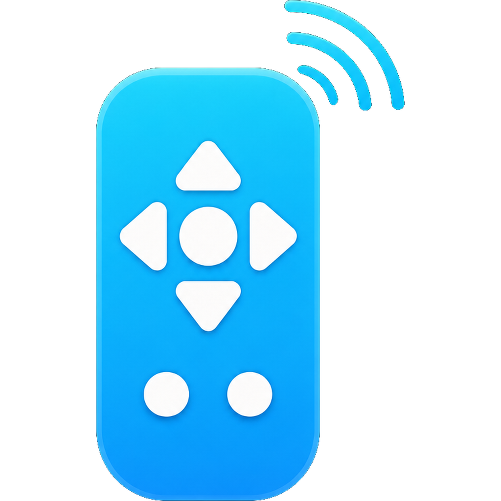
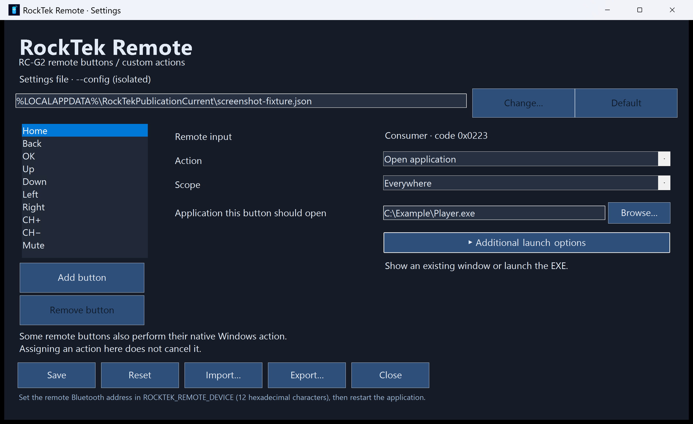

# RockTek Remote

<p align="center"></p>

**[Полная документация на русском](README.md)**

A per-user Windows application for mapping a RockTek RC-G2 Bluetooth remote to keyboard shortcuts, application opening, files and links, mouse clicks and action sequences. Includes a graphical editor, button learning, light/dark themes, a tray menu and a self-contained installer. On first launch the interface follows the Windows UI language: Russian for Russian Windows, English otherwise. Use **Язык / Language** in the editor to switch; the choice is saved for later launches.

## Additional RC-G2 button catalog

[Observed codes for 25 additional buttons](catalog/README.md) are available as a separate JSON fragment. All additional entries are disabled; existing assignments are preserved. Adding the entries to your primary JSON does not require reinstalling the application.

## Requirements and limitations

- 64-bit Windows with .NET Framework 4.x and Windows PowerShell. Designed for Windows 11.
- A paired RC-G2 remote whose input matches the supported Consumer HID reports (report ID `02`, five bytes) or Keyboard Raw Input packets.
- The remote's Bluetooth address must be configured explicitly. No personal device address is built into the application.
- Run as the normal interactive user. Windows can block input sent to elevated applications.
- No custom driver or AutoHotkey is required. The machine-level Back component requires administrator installation. Executables are unsigned.

Support is limited to events Windows actually receives. A button that sends no supported Bluetooth event cannot be assigned. Some buttons also perform native Windows actions; assigning or disabling an action here does not necessarily suppress those actions. Mute remains native; Home has dedicated BrowserHome handling. Do not run two input handlers simultaneously.

## Display-off Home and limitations

When Windows reports display-off and then display-on, an unmatched BrowserHome key can invoke the saved Home action once within the short wake interval. This handles the keyboard-hook suppression path without requiring the original WM_INPUT packet to reach the application. The selected remote Consumer collection must still be present. Recent target Home duplicates are suppressed for two seconds after this fallback; a rapid second Home press can therefore be ignored.

**This is a compromise, not device attribution:** a normal keyboard BrowserHome press in the same display-wake interval can also invoke the saved Home action. Screen-on unmatched BrowserHome is replayed normally. Do not use this fallback where that keyboard-wake risk is unacceptable. Display-off is not system sleep or Wake-on-LAN.

Display-off control uses a direct nonexclusive read of the selected remote's Consumer HID collection only. Keyboard Raw Input remains available; ordinary Consumer Raw Input is the fallback when the direct reader is unavailable. One primary Consumer transport prevents duplicate action dispatch.

With the display off, unmodified keys assigned to **Only in selected application** are delivered as window messages directly to that application's active window, without system `SendInput`. Exact-image-path and foreground-scope checks remain in place. This does not wake the display, disable Modern Standby or create a permanent keep-awake request. Normal keyboard injection is retained while the display is on.

Murglar supports the verified display-off path for `Space` pause/resume, `Left`/`Right` seeking, hold repetition and stopping on release. CH+/CH− control system volume; native Mute is retained. Home wakes the display and shows the selected application; transient foreground refusals are retried for a bounded interval without launching a duplicate instance.

**Limitations:** display-off window delivery supports unmodified keyboard keys only, not Ctrl/Alt/Shift/Win combinations or media key codes. Unsupported combinations and delivery failures are logged rather than falling back to waking `SendInput`. Other applications may ignore window messages. Global keyboard actions, mouse actions and other action types do not have this dark-display guarantee. Verify your selected application's behavior after installation. Authentication screens and manual Windows locking are not bypassed; the application does not change power, lock or Bluetooth settings.

## Back without display wake

Setup 2.1.0 installs `%ProgramData%\RockTekRemote\NativeBack` and the SYSTEM task `RockTekRemote-NativeBack`. Installing/removing this machine component requires administrator approval; the mapper remains a normal-user application.

While direct target HID intake is active and Back has a custom action, the component intercepts hidserv's duplicate BrowserBack before delivery through `WinStationSendWindowMessage`. Consumer `0x0224` still executes its saved mapping; use `P` scoped to Murglar for previous track. The system `hidserv.dll` on disk is unchanged; Mute and all other native messages are forwarded.

The hook remains active for the mapper's lifetime, not a one-minute window. A retained mapper process handle governs independent restoration of the original pointer and page protection on normal exit or process death, without standby-sensitive heartbeats. The SYSTEM task reconnects after mapper/service restarts. Updating/removing a loaded helper briefly restarts hidserv to release its resident DLL, preserving service startup mode.

**Boundary:** the native service message has no source HID identity, so its BrowserBack filter is process-wide and may affect other Consumer remotes. Ordinary keyboard BrowserBack is not directly filtered by this component. Support is pinned to hidserv.dll 10.0.26100.4484, SHA-256 `92d5e4adc8e8128b17c74999df3ad882db5f10c4f27ea31fab55377b1303027a`; other builds fail closed without disabling other mapper functionality. The component log is `runner-phase.log` in its machine directory. A portable EXE without the machine component does not provide this fix.



## Pair and identify your remote

1. Pair the remote through Windows Bluetooth settings. RC-G2 units commonly enter pairing mode by holding Back + Home until the green indicator flashes quickly.
2. In Device Manager, inspect the paired remote's **Details → Device instance path**. Find its Bluetooth address: twelve hexadecimal digits, without separators. PowerShell can help list Bluetooth instances:

   ```powershell
   Get-PnpDevice -Class Bluetooth | Select-Object FriendlyName, InstanceId
   ```

   Select the address belonging to your remote, not the Bluetooth adapter or another device. The address must also appear in the remote's HID Raw Input device path; if your unit uses a different identifier/report layout, source adaptation may be necessary.
3. Store the address as a **user** environment variable. Replace the placeholder with your own address; do not use the placeholder literally:

   ```powershell
   $address = '<12 hexadecimal digits from your remote>'
   [Environment]::SetEnvironmentVariable('ROCKTEK_REMOTE_DEVICE', $address, 'User')
   $env:ROCKTEK_REMOTE_DEVICE = $address
   ```

   Restart the application after changes. Sign out/in if applications launched from the Start menu still inherit the old environment. An absent or invalid address fails closed: no device is remapped. The editor remains available and shows a setup warning.

This device filter applies before decoding, learning and dispatch. Ordinary keyboards and other remotes are excluded from device-identified decoding, learning and dispatch. The BrowserHome wake fallback described below is a deliberate exception. Keep your address private when sharing logs or configuration examples. Existing button-settings JSON files do not need their mappings rewritten to select a device.

## Install and configure

Download the ready-to-run files from the [latest release](https://gitea.nkdb.ru/admin/rocktek-remote/releases/tag/v2.1.1).

- **Installer:** download `RockTekRemoteSetup.exe` and follow the steps below.
- **Portable:** download `RockTekRemote-portable.zip`, extract it to a folder you control and run `RockTekRemote.exe`. It does not install shortcuts or autostart entries; stop any other handler before launching it. Configure the remote and settings as described below.
- **Source:** `RockTekRemote-source.zip` contains the complete source tree, tests and current screenshots.
- `SHA256SUMS` contains SHA-256 checksums for the application, installer and portable ZIP.

1. Run the downloaded `RockTekRemoteSetup.exe` as your ordinary user.
2. Setup installs the application under `%LOCALAPPDATA%\Programs\RockTekRemote`, adds a Start menu settings shortcut, an HKCU Windows Apps uninstall entry and an HKCU Run autostart entry.
3. Setup does not start the handler immediately. Launch the installed `RockTekRemote.exe` to start now, or sign in again. Stop any previous portable handler and disable its autostart yourself before starting this version.
4. Open settings from Start or the tray. For Home choose **Open application** and select its EXE. For each application-restricted button choose **Only in selected application** and select that button's scope EXE. Opening and scope EXEs are independent.
5. Edit a button and click **Save**. Fresh defaults have no selected applications; the first valid Save creates the JSON. The editor will not guess a player or silently turn a restricted button into a global one.

The language selector changes display text only, not paths, key tokens, learned names or assignments. Language is saved separately from mappings in `%LOCALAPPDATA%\RockTekRemote\ui-language.txt`; the theme is session-local. Launch with `--language ru` to start the application, settings editor or installer in Russian; `--language en` selects English. Existing versioned settings and older path-only settings remain readable.

## Actions

### Key / shortcut

Enter a key such as `Space`, `Enter` or `Ctrl+Right`, or click **Record shortcut** and press a key with optional Ctrl, Alt and Shift. Modifier-only presses keep waiting. Esc, Cancel, focus loss or closing restores the prior value. Tab and Alt+F4 are consumed while recording. Recording uses the opted-in active settings window, not an additional global keyboard hook.

Manual keys include English letters/digits, arrows, Home/End, PageUp/PageDown, Insert/Delete, F1–F24 and supported media/volume keys. Ctrl, Shift, Alt and Win modifiers cannot be duplicated. Enter Win shortcuts and Escape manually; Windows-reserved shortcuts are not universally capturable. Save is required to persist recording.

### Open application

Select a local `.exe`. A visible window in the current session with the exact executable path is restored/focused; if none exists, the executable is launched. Failed foreground activation does not cause a duplicate launch.

**Additional launch options** exposes arguments and an optional working directory. Collapsing the section preserves values. These options apply only to new launches. Arguments are passed verbatim; supply any required quoting. An empty working directory means the EXE's parent directory. Paths support environment variables and resolve relative to the settings JSON directory. The EXE and working directory must exist when executed. Launching does not use a command shell or implicit elevation. Network/device paths, drive-relative paths and reserved device names are rejected.

### Open file / folder / link

Open a local file/folder through its Windows association, or an HTTP/HTTPS URL in the browser. Executables, scripts, shortcuts and other URL schemes are refused here; use the explicit application action for EXEs. This is not a shell-command editor.

### Mouse (current pointer)

Left click, right click, double click or wheel scrolling at the pointer's **current** position. Scroll amount is −100 to 100 notches, excluding zero; positive is up. There is no cursor movement or X/Y coordinate targeting. Check what is under the pointer before pressing a mapped button.

### Sequence

Click **Edit steps…**, add/edit/reorder/remove steps, then **Done** and **Save**. Steps support keys, application opening, file/folder/link opening, mouse and waits. Limits: 1–32 steps, no nested sequences, each wait 0–10000 ms and total waits at most 60000 ms.

A single cancellable worker executes steps in order; overlapping actions are refused, not queued. Reloading settings or exiting cancels remaining steps. Cancellation does not undo effects already performed. Waits are delays, not application-readiness checks. Keys use the current foreground window and mouse actions the current pointer. Restricted scopes are rechecked before every step.

**Disabled** affects only this application's output. **Native action** is reserved for Mute and sends no extra toggle.

## Scopes, holding and defaults

Each button has its own scope. **Everywhere** permits the action regardless of the foreground application. **Only in selected application** requires a nonempty local scope EXE and matches the exact foreground executable path. A restricted button may open a different application, but only while its scope application is active.

Repeat is available only for Key actions, excluding Home, Back, OK and Mute. Delay: 100–5000 ms; interval: 50–2000 ms; defaults: 350/150. Repetition stops on the corresponding release or scope loss, with a 30-second lost-release safety cap. Other-source/wrong-key releases do not clear an unrelated hold.

| Button | Default output | Scope | Repeat |
|---|---|---|---|
| Home | Open/focus selected application | Everywhere | No |
| Back | Escape | Selected application | No |
| OK | Space | Selected application | No |
| Up / Down | Up / Down | Selected application | Yes |
| Left / Right | Left / Right | Selected application | Yes |
| CH+ / CH− | VolumeUp / VolumeDown | Everywhere | Yes |
| Mute | Native Windows mute | Native | No |

These are keys, not universal playback or seek commands. Configure shortcuts for your application. Standard Consumer usages are Home `0x0223`, Back `0x0224`, OK `0x0041`, Up/Down `0x0042`/`0x0043`, Left/Right `0x0044`/`0x0045`, CH+/CH− `0x009C`/`0x009D`, Mute `0x00E2`. Different remote firmware may report different codes; learning cannot manufacture missing Bluetooth events.

## Learn another button

Click **Add button**, then press one remote button within 30 seconds. A known source + code selects its existing entry without duplication. For a new event, enter the physical button's name, choose an action and Save. New buttons start Disabled. **Remove button** removes only custom entries and also requires Save.

The input row shows source and hexadecimal code, with keyboard key/scan metadata available in diagnostics. A reported F2 is a signal name, not necessarily the printed button label. Learning distinguishes Consumer and Keyboard sources and temporarily pauses the handler; confirmation, cancel, timeout or closing releases that pause. Up to 256 total buttons are allowed; custom names are unique, 1–48 characters without control characters.

## Settings and compatibility

Runtime, editor and manual editing use one version-4 JSON with `Version` and `Buttons`. Each button stores `InputType`, `Usage`, `ScanCode`, `ScanFlags`, `Action`, `Key`, `Scope`, `ScopeApplicationPath`, `Repeat`, `Delay` and `Interval`. Actions additionally use `ApplicationPath`, `Arguments`, `WorkingDirectory`, `Target`, `MouseAction`, `ScrollAmount` or `Steps`; wait steps use `WaitMilliseconds`.

Action tokens are `Key`, `LaunchApplication`, `OpenTarget`, `Mouse`, `Sequence`, `Wait` (steps only), `Disabled` and `Native`. Legacy `OpenTargetApplication` remains an application-opening alias. Older path-only `MurglarPath` files and versions 2/3/4 migrate without discarding existing paths, assignments, input identity or hold timing. Missing legacy per-button scope paths inherit the old global application path; explicit existing paths are not overwritten. New saves omit the legacy global application field. Empty restricted scope paths must be repaired before Save.

Save validates before atomic replacement. Invalid edits preserve the previous file. Runtime reloads changes approximately once per second and retains the last valid configuration after a bad edit; initial invalid loads use defaults without overwriting the source. **Reset** changes the editor in memory; **Import** loads a validated file; both require Save. **Export** writes a separate copy. Import/export/relocation preserve settings-relative path meaning.

### Primary file location

Default discovery uses `%OneDriveConsumer%\RockTekRemote\settings.json`, then `%OneDrive%\RockTekRemote\settings.json`, an existing `%USERPROFILE%\OneDrive` if those variables are absent, or `%LOCALAPPDATA%\RockTekRemote\settings.json` otherwise.

**Change…** loads an existing JSON without overwriting it or creates a new file from current settings after confirmation. New files are written before the primary locator is committed. **Default** restores default discovery after confirmation. `%LOCALAPPDATA%\RockTekRemote\config-location.json` contains only the selected path, not mappings. Runtime follows changes; a stale editor refuses to save over another window's selection. Invalid locators block Save until repaired. Settings and locator survive uninstall.

`--config <file>` bypasses the locator and disables primary-selection controls. To inspect settings without installing input hooks:

```powershell
.\dist\RockTekRemote.exe --settings-only --config 'C:\YourFolder\settings.json'
.\dist\RockTekRemote.exe --preview --language ru --config 'C:\YourFolder\settings.json'
```

The editor uses DPI-aware fitting and scrollable content with fixed Save/status controls; it does not change Windows display settings.

## Backup, diagnostics and removal

Back up your JSON, sources and installer. After reinstalling Windows, pair the remote again, configure the user device environment variable, reinstall and reselect your JSON. The local primary-file locator is not automatically synced. `restore.ps1` runs `dist\RockTekRemoteSetup.exe` silently and verifies the installed EXE; supply `-SetupPath` for a different installer location. It creates no extra startup task.

Logs/state are `%LOCALAPPDATA%\RockTekRemote\actions.log` and `state.json`. Logs are capped; successful dispatch does not prove the target application responded. Check the selected address, process path, foreground scope and application shortcuts when diagnosing a button. Exit from the tray stops handling until the next launch/sign-in.

Remove through Windows Settings → Apps → RockTek Remote, or run the installed EXE with `--uninstall` (`--silent` suppresses confirmation). Removal targets the owned EXE, shortcut and current-user registry entries, not selected applications, pairing, settings, locator, backups or unknown files. The user device environment variable is retained; remove it yourself if no longer needed.

## Developer information

### Build on Windows

From the repository on 64-bit Windows:

```powershell
powershell.exe -NoProfile -ExecutionPolicy Bypass -File .\build.ps1
```

The script uses `%WINDIR%\Microsoft.NET\Framework64\v4.0.30319\csc.exe` and produces:

- `dist\RockTekRemote.exe` — application and settings editor.
- `dist\RockTekRemoteSetup.exe` — installer with that exact application embedded.

Use `-OutputDirectory <folder>` to choose another output location. Icons and all source files needed for both executables are included. Generated executables, settings, logs and capture files are not part of the source distribution. No third-party NuGet dependencies are required.

### Windows regression suite

```powershell
powershell.exe -NoProfile -ExecutionPolicy Bypass -File .\test.ps1
```

Run after `build.ps1`. The suite covers mappings, holding, configuration, native input boundaries, Home wake routing with a fake OS adapter, editor, localization, configurable device filtering and sandbox installation/removal. Installer safety checks reject redirected paths and ownership markers. Tests do not install or replace the current-user production runtime, modify production startup tasks or assert physical media behavior.

### Build on Linux

With Mono's C# compiler, Windows Forms, Drawing and Web Extensions framework assemblies, plus `zip`, available:

```bash
bash ./build.sh
```

On Linux, install `mono-devel` with the .NET Framework 4.5 reference assemblies. `build.sh` uses `mcs -sdk:4.5`; a missing SDK aborts the build rather than substituting the current Mono runtime API.

This compiles the same source lists and embedded resources as `build.ps1` and writes `RockTekRemote.exe`, `RockTekRemoteSetup.exe`, `RockTekRemote-portable.zip` and `SHA256SUMS` to ignored `dist/`. The installer embeds the newly compiled application; the portable ZIP contains only that application. These are Windows executables, not a Linux application.

## Source layout

- `RockTekRemote.cs`, `HidConsumerReader.cs`, `ConsumerInput.cs`, `DeviceFilter.cs`: filtered Windows input, runtime, tray and device selection.
- `RemoteConfig.cs`, `ActionModel.cs`, `ConfigLocation.cs`, `FileSafety.cs`: validation, migration, persistence and path safety.
- `ActionExecutor.cs`, `RemoteMapping.cs`, `HoldRepeater.cs`: cancellable execution, defaults and holds.
- `SettingsForm.cs`, `ActionEditor.cs`, `UiText.cs`, `WindowLayout.cs`, `AppIcon.cs`: bilingual editor, sequence UI, DPI layout and icons.
- `Installation.cs`, `Setup.cs`, `build.ps1`, `build.sh`, `restore.ps1`: per-user packaging and recovery.
