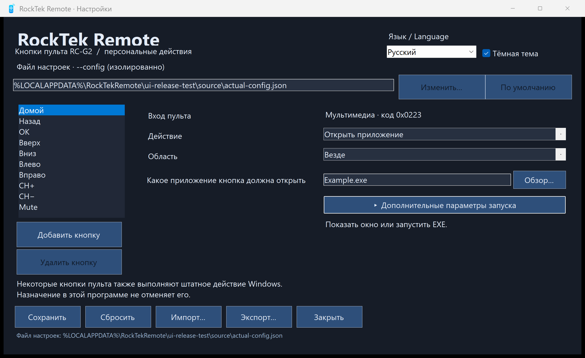

# RockTek Remote

<p align="center"></p>

**[Full English documentation](README.en.md)**

Приложение Windows для назначения кнопкам Bluetooth-пульта RockTek RC-G2 сочетаний клавиш, открытия приложений, файлов и ссылок, щелчков мыши и последовательностей действий. В комплекте графический редактор, обнаружение кнопок, светлая/тёмная тема, меню в трее и самостоятельный установщик. При первом запуске язык интерфейса соответствует языку Windows: русский для русской системы, английский для остальных. В верхней части редактора доступен переключатель **Язык / Language**; выбранный язык сохраняется для последующих запусков.

## Готовые профили CloudMus и Murglar

В установщик и переносимый ZIP входят оба готовых JSON-профиля и два помощника: `CloudMusPlayPause.exe` и `MurglarRemote.exe`. Отдельная установка помощников, AutoHotkey и ручная сборка не нужны. Установщик размещает профили в `%LOCALAPPDATA%\Programs\RockTekRemote\profiles`; в переносимой версии это папка `profiles` рядом с EXE. Выберите нужный JSON через выбор основного файла настроек. Уже выбранный профиль, личные назначения и существующие файлы профилей при обновлении не заменяются.

- **Home** запускает закрытый плеер либо показывает существующий экземпляр и ждёт готовности интерфейса. Повторный Home может включить экран; подавления пробуждения нет.
- **CloudMus 0.6.3:** первое **OK** вызывает настоящую кнопку воспроизведения выбранного плейлиста; следующие нажатия ставят паузу и продолжают. При холодном запуске помощник устанавливает только `[window] closeMinimizesToTray=false`, чтобы крестик завершал приложение, а не скрывал его в трей. Стандартная установка и обновление CloudMus сохраняются. Закладка отправляет штатную `L`, настройки — `D`.
- **Murglar Desktop 6.8.163:** первое **OK** без загруженного трека запускает **«Мою волну» Яндекса**; затем — пауза/продолжение. **Закладка** переключает обычное сердечко. **Настройки** автоматически выбирают **«Не рекомендовать трек»**, никогда не исполнителя. Murglar завершает запрещённый трек и переходит к следующему; это не переключатель отмены запрета.
- OK и оценки работают только при активном точном EXE своего плеера и без повтора. Используются Windows UI Automation и встроенный Java Access Bridge, без координат, движения мыши и запасного Space. Для нового запуска Murglar Java Accessibility включается только в окружении этого процесса; глобальные настройки Java не меняются. Ранее запущенный Murglar без Accessibility потребуется закрыть и открыть через Home.
- **Назад** в этих профилях отправляет `P`, стрелки — свои обычные клавиши, CH+/CH− — системную громкость; Mute остаётся нативным. Не назначенные сервисные и цифровые кнопки отключены. Выключение компьютера по кнопке питания **по умолчанию отключено**.

Пути шаблонов: CloudMus — `%LOCALAPPDATA%\Programs\CloudMus\cloudmus-qt.exe`, Murglar — `%USERPROFILE%\OneDrive\Murglar-Desktop-windows-x64\Murglar.exe`. Если плеер находится в другом месте, измените его EXE в области ограниченных кнопок и параметр `--application "полный путь к EXE"` у Home, OK и оценок помощника. Относительный путь `../...exe` открывает помощника из соседней папки программы; при переносе JSON через редактор его путь корректно пересчитывается. Для Murglar нужен вход в Яндекс и доступная «Моя волна»; авторизация и данные плееров в поставку не входят.

Журналы помощников находятся в `%LOCALAPPDATA%\RockTekRemote`: `cloudmus-open-state.txt`, `cloudmus-playpause-state.txt`, `murglar-open-state.txt`, `murglar-playpause-state.txt`, `murglar-like-state.txt`, `murglar-dislike-state.txt`. Смена активного приложения во время команды отклоняет действие. Новая версия не меняет настройки питания и блокировки Windows.

## Каталог дополнительных кнопок RC-G2

[Проверенные коды 25 дополнительных кнопок](catalog/README.md) опубликованы в отдельном JSON-фрагменте. Все дополнительные записи отключены; существующие назначения сохраняются. Добавление этих записей в основной JSON не требует переустановки приложения.

## Требования и ограничения

- 64-битная Windows, .NET Framework 4.x и Windows PowerShell. Приложение рассчитано на Windows 11.
- Сопряжённый RC-G2, передающий поддерживаемые Consumer HID-пакеты (ID `02`, пять байтов) либо Keyboard Raw Input.
- Bluetooth-адрес своего пульта необходимо указать явно. Персональный адрес устройства не встроен в исходники.
- Запускайте программу от обычного пользователя в интерактивном сеансе: Windows может блокировать отправку ввода в приложения с повышенными правами.
- Сторонний драйвер и AutoHotkey не требуются. Для машинного компонента «Назад» нужны права администратора. EXE не подписаны.

Назначить можно только событие, которое действительно получает Windows. Кнопку без поддерживаемого Bluetooth-события добавить нельзя. Некоторые кнопки одновременно выполняют штатное действие Windows: назначение или отключение действия здесь не обязательно отменяет штатное. Mute остаётся нативным; Home имеет отдельную обработку BrowserHome. Не запускайте два обработчика одновременно.

## Home при выключенном экране и ограничения

После уведомлений Windows о выключении и включении экрана необработанный BrowserHome может однократно выполнить сохранённое действие Home в коротком интервале пробуждения. Обработка не требует исходного WM_INPUT, который подавляет клавиатурный перехватчик. Consumer-коллекция выбранного пульта должна присутствовать. Повторные целевые Home подавляются две секунды после этой обработки; быстрое второе нажатие Home также может быть проигнорировано.

**Это компромисс, не определение устройства:** BrowserHome обычной клавиатуры в том же интервале пробуждения тоже может выполнить сохранённое действие Home. При уже включённом экране необработанный BrowserHome воспроизводится штатно. Не используйте эту обработку, если такой риск для обычной клавиатуры неприемлем. Выключение экрана не означает сон компьютера или Wake-on-LAN.

Управление при погасшем экране использует прямое неэксклюзивное чтение только Consumer HID-коллекции выбранного пульта. Keyboard Raw Input сохраняется; при недоступном прямом чтении остаётся обычный Consumer Raw Input. Один основной Consumer-путь предотвращает двойное выполнение команды.

Одиночные клавиши кнопок с областью **Только в выбранном приложении** при выключенном экране передаются сообщениями непосредственно в активное окно этого приложения, без системного `SendInput`. Проверка точного EXE и активной области сохраняется. Пробуждение экрана, запрет Modern Standby и постоянное удерживание компьютера бодрствующим не используются. При включённом экране применяется обычная отправка клавиш.

Для Murglar проверены пауза/воспроизведение через `Space`, перемотка через `Left`/`Right`, повтор при удержании и прекращение после отпускания без включения экрана. CH+/CH− управляют системной громкостью; штатный Mute сохраняется. Home пробуждает экран и показывает выбранное приложение; при временном отказе Windows активация существующего окна повторяется ограниченное время, без запуска второго экземпляра.

**Ограничения:** при тёмном экране доставка сообщений окну поддерживает только одиночные клавиши без Ctrl/Alt/Shift/Win и без медиа-кодов. Неподдерживаемое сочетание или отказ доставки вызывает ошибку в журнале, а не пробуждающую подмену через `SendInput`. Другие приложения могут не обрабатывать такие сообщения. Глобальные клавиши, мышь и прочие действия не получают этой гарантии сохранения тёмного экрана. Проверяйте поведение выбранного приложения после установки. Защищённый экран входа и ручная блокировка Windows не обходятся; приложение не изменяет параметры питания, блокировки или Bluetooth.

## «Назад» без включения экрана

Установщик включает машинный компонент `%ProgramData%\RockTekRemote\NativeBack` и задачу `RockTekRemote-NativeBack` от SYSTEM. Для установки/удаления компонента требуется подтверждение администратора; сам обработчик работает от обычного пользователя.

При активном прямом HID-чтении и назначенном действии Back компонент перехватывает дублирующую команду BrowserBack внутри работающей `hidserv` до её доставки через `WinStationSendWindowMessage`. Физическая Consumer-кнопка `0x0224` по-прежнему выполняет сохранённое действие; для предыдущего трека Murglar назначьте `P` и область Murglar. Системная `hidserv.dll` на диске не изменяется, Mute и остальные команды службы передаются штатно.

Перехват действует всё время работы обработчика, а не одну минуту. Его жизненный цикл привязан к открытому дескриптору процесса обработчика: выход или аварийное завершение возвращает исходный указатель и защиту памяти независимо от запускающей программы. Сон не завершает эту привязку. После перезапуска обработчика или службы задача подключает компонент снова. При обновлении/удалении загруженного компонента `hidserv` кратковременно перезапускается для освобождения DLL; режим запуска службы не меняется.

**Граница:** у команды службы нет идентификатора исходного HID-устройства. Фильтр BrowserBack в `hidserv` процессный и может затронуть другие Consumer-пульты; обычный BrowserBack клавиатуры напрямую не фильтруется этим компонентом. Поддерживается только точная сборка `hidserv.dll` 10.0.26100.4484 с SHA-256 `92d5e4adc8e8128b17c74999df3ad882db5f10c4f27ea31fab55377b1303027a`. Несовпадение версии не разрешает вмешательство: компонент отказывает, остальные функции обработчика остаются доступны. Журнал компонента — `runner-phase.log` в его машинной папке. Переносимый EXE без машинного компонента не обеспечивает это исправление.



## Сопряжение и выбор устройства

1. Подключите пульт через Bluetooth-настройки Windows. У RC-G2 режим сопряжения обычно включается удерживанием Back + Home до быстрого зелёного мигания.
2. В Диспетчере устройств откройте свойства сопряжённого пульта: **Сведения → Путь к экземпляру устройства**. Найдите его Bluetooth-адрес — двенадцать шестнадцатеричных цифр без разделителей. Список Bluetooth-экземпляров можно посмотреть в PowerShell:

   ```powershell
   Get-PnpDevice -Class Bluetooth | Select-Object FriendlyName, InstanceId
   ```

   Выберите адрес пульта, не адаптера и не другого устройства. Адрес должен присутствовать и в HID Raw Input-пути пульта; для устройства с другим идентификатором или форматом пакетов может потребоваться изменение исходников.
3. Запишите адрес в переменную среды **текущего пользователя**, заменив пример своим значением. Не используйте строку-заглушку буквально:

   ```powershell
   $address = '<12 hexadecimal digits from your remote>'
   [Environment]::SetEnvironmentVariable('ROCKTEK_REMOTE_DEVICE', $address, 'User')
   $env:ROCKTEK_REMOTE_DEVICE = $address
   ```

   После изменения перезапустите программу. Если запуск из меню Пуск получает прежнюю среду, выйдите из Windows и войдите снова. Без корректного адреса обработка запрещена: программа не переназначает никакие устройства. Окно настроек доступно и показывает предупреждение.

Фильтр применяется до декодирования, обучения и выполнения действий. Обычные клавиатуры и чужие пульты исключены из декодирования, обучения и выполнения событий с идентификатором устройства. Описанный ниже BrowserHome при пробуждении — намеренное исключение. Не публикуйте личный адрес в журналах или примерах. Для выбора устройства не нужно переписывать назначения существующего JSON.

## Установка и начало работы

Скачайте готовые файлы из [последнего выпуска](https://gitea.nkdb.ru/admin/rocktek-remote/releases/tag/v2.2.0).

- **Установщик:** скачайте `RockTekRemoteSetup.exe` и следуйте шагам ниже.
- **Переносимая версия:** скачайте `RockTekRemote-portable.zip`, распакуйте в доступную вам папку и запустите `RockTekRemote.exe`. Она не создаёт ярлыки и записи автозапуска; перед запуском остановите другой обработчик. Устройство и назначения настройте по инструкции ниже.
- **Исходники:** `RockTekRemote-source.zip` содержит полный набор исходников, тесты и текущие снимки окна.
- `SHA256SUMS` содержит контрольные суммы SHA-256 приложения, установщика, помощников, обоих профилей и переносимого ZIP.

1. Запустите скачанный `RockTekRemoteSetup.exe` от обычного пользователя.
2. Программа устанавливается в `%LOCALAPPDATA%\Programs\RockTekRemote`, создаёт ярлык настроек в меню Пуск, запись удаления в HKCU для списка приложений Windows и автозапуск HKCU Run.
3. Установщик не запускает обработчик сразу. Откройте установленный `RockTekRemote.exe` для запуска сейчас либо войдите в Windows заново. Предыдущий переносимый обработчик остановите и отключите его автозапуск самостоятельно до запуска этой версии.
4. Откройте настройки из меню Пуск или трея. Для Home выберите **Открыть приложение** и его EXE. Для каждой ограниченной кнопки выберите **Только в выбранном приложении** и укажите EXE её области. Путь открываемого приложения и путь области независимы.
5. Настройте кнопку и нажмите **Сохранить**. В новых стандартных настройках приложения не выбраны; первый корректный Save создаёт JSON. Программа не угадывает плеер и не заменяет ограниченную область глобальной.

Выбор языка меняет только отображаемый текст, не пути, английские токены клавиш, имена добавленных кнопок или назначения. Язык сохраняется отдельно от назначений в `%LOCALAPPDATA%\RockTekRemote\ui-language.txt`; тема действует в текущем сеансе. `--language ru` запускает обработчик, редактор или установщик на русском; `--language en` — на английском. Старые версионные и path-only настройки продолжают читаться.

## Действия

### Клавиша / сочетание

Введите `Space`, `Enter`, `Ctrl+Right` либо нажмите **Записать сочетание** и клавишу с необязательными Ctrl, Alt, Shift. Нажатие только модификатора оставляет ожидание. Esc, Отмена, потеря фокуса и закрытие возвращают прежнее значение. Tab и Alt+F4 во время записи не выполняют команды окна. Используются события активного окна после явного включения записи, а не дополнительный глобальный перехватчик клавиатуры.

Ручной ввод поддерживает латинские буквы/цифры, стрелки, Home/End, PageUp/PageDown, Insert/Delete, F1–F24 и поддерживаемые медиа/громкостные клавиши. Модификаторы Ctrl, Shift, Alt, Win нельзя дублировать. Win-сочетания и Escape вводите вручную: системные сочетания не всегда доступны для записи. Для сохранения результата нужен **Сохранить**.

### Открыть приложение

Выберите локальный `.exe`. Если в текущем сеансе есть видимое окно с точным путём этого EXE, оно восстанавливается и активируется; иначе приложение запускается. Отказ Windows перевести окно на передний план не создаёт второй запуск.

**Дополнительные параметры запуска** раскрывают аргументы и необязательную рабочую папку. Сворачивание сохраняет значения. Они используются только при новом запуске. Аргументы передаются без изменения; необходимые кавычки задайте сами. Пустая рабочая папка означает папку EXE. Поддерживаются переменные среды и пути относительно папки JSON. Приложение и рабочая папка должны существовать при выполнении. Командная оболочка и автоматическое повышение прав не используются. Сетевые/служебные пути, пути вида `C:foo` и зарезервированные имена устройств запрещены.

### Открыть файл / папку / ссылку

Локальные файлы и папки открываются через штатную ассоциацию Windows, HTTP/HTTPS-ссылки — в браузере. Исполняемые файлы, сценарии, ярлыки и другие протоколы запрещены: EXE запускайте отдельным действием приложения. Это не редактор командной строки.

### Мышь (текущий курсор)

Левый, правый или двойной щелчок либо колесо в **текущем** положении указателя. Прокрутка: от −100 до 100 делений, кроме нуля; положительное значение — вверх. Перемещения курсора и координат X/Y нет. Перед нажатием проверьте элемент под курсором.

### Последовательность

Откройте **Редактировать шаги…**, добавьте, настройте, переставьте или удалите шаги, затем нажмите **Готово** и **Сохранить**. Поддерживаются клавиши, открытие приложений, файлов/папок/ссылок, мышь и ожидание. От 1 до 32 шагов, без вложенных последовательностей. Ожидание шага: 0–10000 мс; сумма ожиданий не более 60000 мс.

Один отменяемый фоновый исполнитель выполняет шаги по порядку; параллельные действия отклоняются, очередь не создаётся. Перечитывание настроек и выход отменяют оставшиеся шаги. Уже выполненные эффекты не откатываются. Ожидание — задержка, не проверка готовности приложения. Клавиши отправляются текущему активному окну, мышь действует под текущим указателем. Область ограниченной кнопки проверяется перед каждым шагом.

**Без действия** отключает только вывод этой программы. **Штатное действие** закреплено за Mute и не создаёт дополнительного переключения.

## Область, удерживание и стандартные назначения

Область задаётся отдельно каждой кнопке. **Везде** разрешает действие независимо от активного приложения. **Только в выбранном приложении** требует непустой локальный EXE области и сравнивает точный путь активного процесса. Ограниченная кнопка может открывать другое приложение, но лишь пока активно приложение её области.

Повтор доступен только для клавиш, кроме Home, Back, OK и Mute. Задержка: 100–5000 мс, интервал: 50–2000 мс; стандартно 350/150. Повтор прекращается при соответствующем отпускании или смене области; защитный предел потерянного отпускания — 30 секунд. Отпускание другой клавиши/источника не сбрасывает чужое удерживание.

| Кнопка | Стандартный вывод | Область | Повтор |
|---|---|---|---|
| Home | Открыть/показать выбранное приложение | Везде | Нет |
| Back | Escape | Выбранное приложение | Нет |
| OK | Space | Выбранное приложение | Нет |
| Up / Down | Up / Down | Выбранное приложение | Да |
| Left / Right | Left / Right | Выбранное приложение | Да |
| CH+ / CH− | VolumeUp / VolumeDown | Везде | Да |
| Mute | Штатное отключение звука Windows | Нативно | Нет |

Это клавиши, а не универсальные команды паузы или перемотки. Настройте сочетания своей программы. Стандартные Consumer-коды: Home `0x0223`, Back `0x0224`, OK `0x0041`, Up/Down `0x0042`/`0x0043`, Left/Right `0x0044`/`0x0045`, CH+/CH− `0x009C`/`0x009D`, Mute `0x00E2`. Другая прошивка может выдавать другие коды; обучение не создаёт отсутствующих Bluetooth-событий.

## Добавление новой кнопки

Нажмите **Добавить кнопку** и одну кнопку пульта в течение 30 секунд. Известная пара источник + код выбирает существующую запись без дубля. Для нового события введите физическое имя, выберите действие и сохраните. Новые кнопки изначально без действия. **Удалить кнопку** доступно только для добавленных записей и также требует сохранения.

Строка входа показывает источник и шестнадцатеричный код; имя клавиши и scan-метаданные доступны в диагностике. F2 — имя сигнала, не обязательно надпись на пульте. Consumer и Keyboard различаются. Во время обучения обработчик приостанавливается; подтверждение, отмена, таймаут или закрытие освобождают блокировку. Максимум 256 кнопок; пользовательские имена уникальны, 1–48 символов без управляющих знаков.

## Настройки и совместимость

Обработчик, окно и ручное редактирование используют один JSON версии 4 с `Version` и `Buttons`. У каждой кнопки: `InputType`, `Usage`, `ScanCode`, `ScanFlags`, `Action`, `Key`, `Scope`, `ScopeApplicationPath`, `Repeat`, `Delay`, `Interval`. Дополнительные поля действий: `ApplicationPath`, `Arguments`, `WorkingDirectory`, `Target`, `MouseAction`, `ScrollAmount`, `Steps`; у ожидания — `WaitMilliseconds`.

Токены: `Key`, `LaunchApplication`, `OpenTarget`, `Mouse`, `Sequence`, `Wait` (только шаг), `Disabled`, `Native`. Старый `OpenTargetApplication` остаётся синонимом открытия приложения. Старые path-only файлы с `MurglarPath` и версии 2/3/4 мигрируют с сохранением путей, назначений, источника/кода и параметров удерживания. Отсутствующие старые пути области получают прежний глобальный путь приложения; явно заданные новые пути не перезаписываются. Новые сохранения не содержат старого глобального поля. Пустые ограниченные EXE необходимо исправить до сохранения.

Save валидирует и атомарно заменяет файл. Ошибка сохраняет прежние байты. Обработчик перечитывает JSON примерно раз в секунду и после плохой правки оставляет последнюю корректную конфигурацию; при первом неправильном чтении использует стандартные значения без перезаписи файла. **Сбросить** меняет окно в памяти; **Импорт** загружает корректный файл; после обоих нужен Save. **Экспорт** пишет отдельную копию. Импорт, экспорт и перенос сохраняют смысл относительных путей.

### Основной файл

Поиск по умолчанию: `%OneDriveConsumer%\RockTekRemote\settings.json`, затем `%OneDrive%\RockTekRemote\settings.json`, существующий `%USERPROFILE%\OneDrive`, если переменных нет, либо `%LOCALAPPDATA%\RockTekRemote\settings.json`.

**Изменить…** загружает существующий JSON без перезаписи или создаёт новый из текущих настроек после подтверждения. Новый файл записывается до фиксации указателя. **По умолчанию** возвращает стандартный поиск после подтверждения. `%LOCALAPPDATA%\RockTekRemote\config-location.json` содержит только путь, не назначения. Обработчик следует изменениям; старое окно отказывается сохранять после выбора другого файла в другом окне. Плохой указатель блокирует Save до исправления. Настройки и указатель сохраняются при удалении.

`--config <файл>` обходит указатель и отключает выбор основного файла. Просмотр без установки input hooks:

```powershell
.\dist\RockTekRemote.exe --settings-only --config 'C:\YourFolder\settings.json'
.\dist\RockTekRemote.exe --preview --language ru --config 'C:\YourFolder\settings.json'
```

Окно учитывает DPI и рабочую область монитора; содержимое прокручивается, Save/статус остаются на месте. Настройки дисплея Windows не меняются.

## Резервная копия, диагностика и удаление

Сохраните JSON, исходники и установщик. После переустановки Windows снова подключите пульт, задайте пользовательскую переменную устройства, установите программу и выберите свой JSON. Локальный указатель автоматически не синхронизируется. `restore.ps1` запускает `dist\RockTekRemoteSetup.exe` без диалога и проверяет установленный EXE; другой путь задаётся через `-SetupPath`. Обработчик использует HKCU Run; отдельная SYSTEM-задача обслуживает только машинный компонент «Назад».

Журнал и состояние: `%LOCALAPPDATA%\RockTekRemote\actions.log` и `state.json`. Размер журналов ограничен; запись об отправке не доказывает реакцию приложения. Для диагностики проверьте адрес, путь процесса, активную область и горячие клавиши приложения. Выход из трея прекращает обработку до следующего запуска/входа.

Удаление: Параметры Windows → Приложения → RockTek Remote либо установленный EXE с `--uninstall` (`--silent` отключает подтверждение). С подтверждением администратора также удаляются машинный компонент и его SYSTEM-задача; назначенные приложения не удаляются. Удаляются принадлежащие установке EXE, ярлык и записи текущего пользователя. Приложения, сопряжение, настройки, указатель, резервные копии и неизвестные файлы сохраняются. Переменная устройства также остаётся: удалите её самостоятельно, если больше не нужна.

## Для разработчиков

### Сборка в Windows

В папке исходников на 64-битной Windows:

```powershell
powershell.exe -NoProfile -ExecutionPolicy Bypass -File .\build.ps1
```

Перед сборкой подготовьте `native/timedhook.dll` и `native/service-runner.exe` командой `python3 native/build.py` на Linux (скачивание проверенного portable LLVM-MinGW); перенесите эти файлы вместе с исходниками на Windows.

Используется компилятор `%WINDIR%\Microsoft.NET\Framework64\v4.0.30319\csc.exe`. Результат:

- `dist\RockTekRemote.exe` — обработчик и окно настроек.
- `dist\RockTekRemoteSetup.exe` — установщик со встроенной точной копией собранного приложения.

Другую папку можно указать через `-OutputDirectory <папка>`. Все необходимые исходники и значки включены. Сгенерированные EXE, настройки, журналы и снимки не входят в исходный комплект. Зависимостей NuGet нет.

### Регрессионные тесты Windows

```powershell
powershell.exe -NoProfile -ExecutionPolicy Bypass -File .\test.ps1
```

Запускайте после `build.ps1`. Набор проверяет назначения, удерживание, конфигурацию, native-границы ввода, Home при пробуждении с подставным OS-адаптером, редактор, локализацию, выбор устройства и установку/удаление в песочнице. Проверки безопасности отклоняют перенаправленные пути и маркеры владения. Тесты не устанавливают и не заменяют рабочий обработчик пользователя, не меняют рабочие задачи автозапуска и не подтверждают физическую реакцию медиа-кнопок.

### Сборка в Linux

Нужны компилятор C# Mono, сборки Windows Forms, Drawing и Web Extensions, а также `zip`:

```bash
bash ./build.sh
```

Для Linux установите пакет `mono-devel` с эталонными сборками .NET Framework 4.5. `build.sh` использует `mcs -sdk:4.5`; отсутствие этого SDK прерывает сборку, а не подменяет Windows API библиотеками текущего Mono.

Сценарий использует те же списки исходников и встроенные ресурсы, что и `build.ps1`, и записывает `RockTekRemote.exe`, `RockTekRemoteSetup.exe`, `RockTekRemote-portable.zip` и `SHA256SUMS` в игнорируемую папку `dist/`. Установщик содержит только что собранное приложение, переносимый ZIP — только приложение. Полученные EXE предназначены для Windows, не для запуска в Linux.

## Исходники

- `RockTekRemote.cs`, `HidConsumerReader.cs`, `ConsumerInput.cs`, `DeviceFilter.cs`: фильтрация, обработчик, трей и выбор устройства.
- `RemoteConfig.cs`, `ActionModel.cs`, `ConfigLocation.cs`, `FileSafety.cs`: валидация, миграция, хранение и безопасность путей.
- `ActionExecutor.cs`, `RemoteMapping.cs`, `HoldRepeater.cs`: отменяемое исполнение, стандартные назначения и удерживание.
- `SettingsForm.cs`, `ActionEditor.cs`, `UiText.cs`, `WindowLayout.cs`, `AppIcon.cs`: двухъязычный редактор, шаги, DPI и значки.
- `Installation.cs`, `Setup.cs`, `build.ps1`, `build.sh`, `restore.ps1`: упаковка и восстановление для текущего пользователя.


